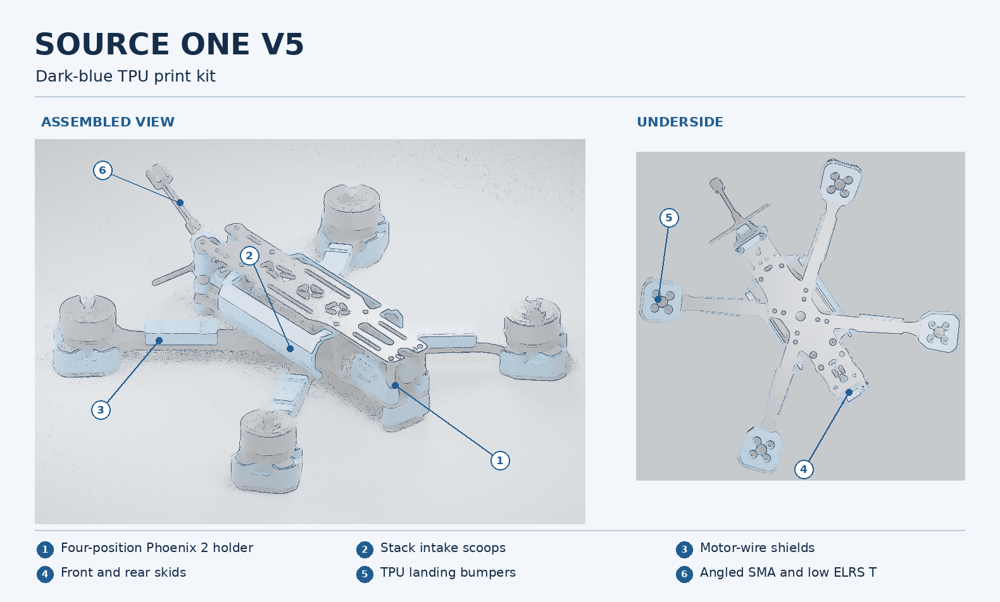

# Source One V5 TPU print kit

A dark-blue accessory set fitted to the supplied TBS Source One V5 frame geometry. The kit includes faceted stack protectors with forward-facing air scoops, a recessed four-position RunCam Phoenix 2 holder, wire shields, wraparound landing bumpers, front and rear skids, and rear radio antenna mounts.

## Download and print

- [Complete ZIP](downloads/Source-One-V5-Dark-Blue-Scoop-Kit.zip)
- [Arranged 17-piece 3MF print plate](downloads/dark-blue-print-plate.3mf)
- [Individual STLs](STL/)
- [Print settings and installation guide](PRINT-AND-FIT.md)
- [Editable OpenSCAD](cad/sourceone-v5-kit.scad)
- [Color 3D assembly](cad/dark-blue-assembly.glb)

The prearranged plate uses 16 × 16 mm motor bumpers. The individual STL folder also includes 19 × 19 mm alternatives. Choose the parts that match your hardware and start with 95A TPU.

## Assembly views

[Assembled view](previews/assembly-preview.jpg) · [Rear cutaway](previews/cutaway-preview.jpg) · [Underside](previews/underside-preview.jpg)

CAD clearance checks used the supplied frame and representative hardware geometry. Check prop clearance and the live camera view with your actual hardware. Cooling and drag performance have not been measured.
