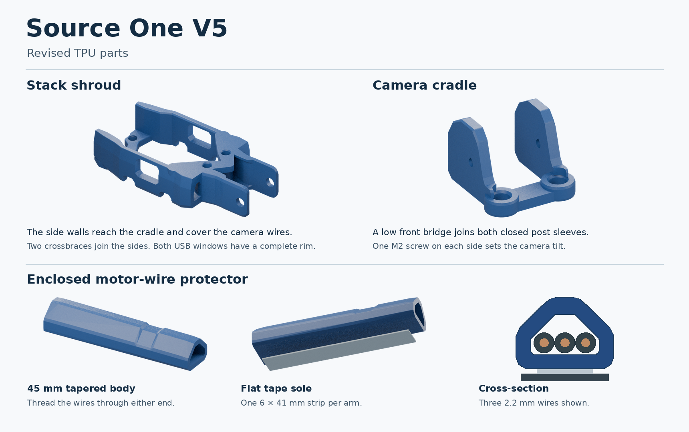

# Source One V5 TPU print kit

Dark-blue TPU parts for the TBS Source One V5. The four-post stack shroud covers the stack with compact USB-C openings, separate motor-wire exits and forward scoops. Its rounded lower rear brace clears the modeled XT60 and capacitor layout. Its front side walls overlap the camera cradle to cover the camera wiring. The RunCam Phoenix 2 cradle places the stock lens between the front posts. Its two sleeves join below the lens and the rear is open for the cable. Two closed eyelets hold a single horizontal ELRS T antenna beneath the reinforced 30° SMA mount. Each 45 mm motor-wire protector has an enclosed tunnel, flared entrances and a flat sole for a 6 × 41 mm strip of 3M tape.

## Download and print

- [Four enclosed wire protectors, two of each hand](downloads/wire-protectors.3mf) · [Preview and cross-section](previews/wire-protectors-preview.png)
- [Two-piece forward camera plate for 19 mm post centers](downloads/forward-camera.3mf) · [20 mm cradle STL](STL/phoenix2-cradle-20mm.stl) · [21 mm cradle STL](STL/phoenix2-cradle-21mm.stl)
- [Six-piece revision plate with the shroud, cradle and all four wire holders](downloads/fit-fix-print-plate.3mf)
- [Complete kit ZIP](downloads/Source-One-V5-Dark-Blue-Scoop-Kit.zip) · [Complete 16-piece print plate](downloads/dark-blue-print-plate.3mf)
- [Individual STLs](STL/) · [Print settings and fit guide](PRINT-AND-FIT.md)
- [Editable OpenSCAD](cad/sourceone-v5-kit.scad) · [Color assembly model](cad/dark-blue-assembly.glb)

Use 95A TPU. Print the shroud tail down, the camera cradle bridge down, and the wire protectors tape side down. Thread the loose motor leads through an end before soldering them to the ESC. The plates include the bolt-free bumper design wherever bumpers are supplied. Each bolt-free shoe slides onto the carbon and uses one 3.6 mm tie with a recessed head. The STL folder also includes 16 × 16 and 19 × 19 mm bolt-on alternatives.

## Assembly views

[Camera wire protection, assembled and exposed](previews/camera-wire-preview.jpg) · [Assembly sketch](previews/sketch-preview.png) · [Assembled frame](previews/assembly-preview.jpg) · [USB cable and camera fit](previews/service-preview.jpg) · [Wire holder and landing shoe](previews/arm-detail-preview.jpg) · [Camera and scoop](previews/nose-preview.jpg) · [Single ELRS antenna mount](previews/rx-antenna-preview.jpg) · [Rear electronics](previews/cutaway-preview.jpg) · [VTX mount and pigtail routing](previews/vtx-mount-preview.jpg) · [Lower rear cover brace](previews/lower-brace-preview.jpg) · [Underside](previews/underside-preview.jpg)

The CAD checks use the supplied frame and modeled hardware. Confirm USB seating, lens clearance, live camera view and tape adhesion on the physical build. Check that the antenna end caps fit through the closed TPU eyelets and that the motor guards grip the carbon.
